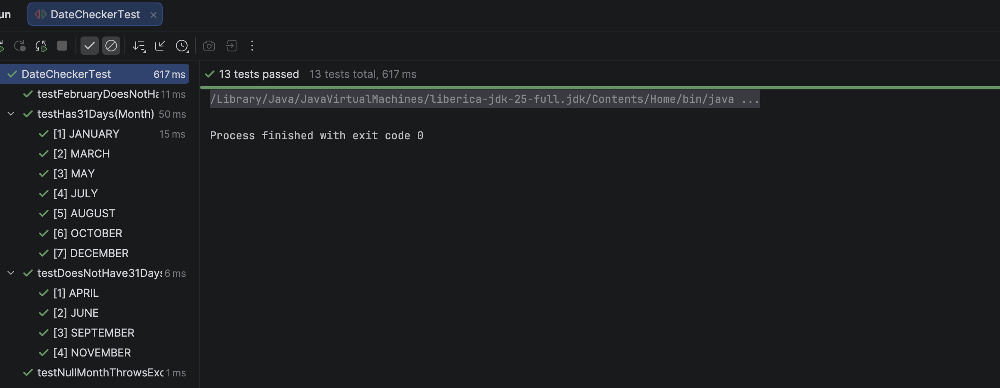

# JUnit TDD Quiz

## Description
This program follows TDD for unit testing on Calculator
and Date Checker implementation.

## Test Instructions
To run the test open the project in IntelliJ,
open the maven tool window and double click test.

## Reflection
To write these tests I implemented the TDD process.
First write a test to fail it, then implement the minimum code needed
to pass the test. After passing the tests, I either added more tests or refactored.

## Test Suite Results

